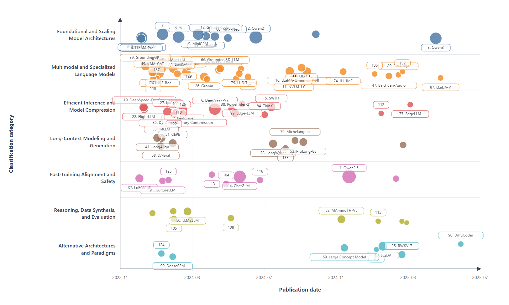
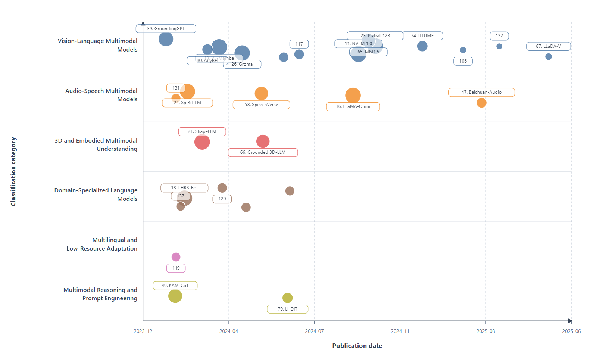
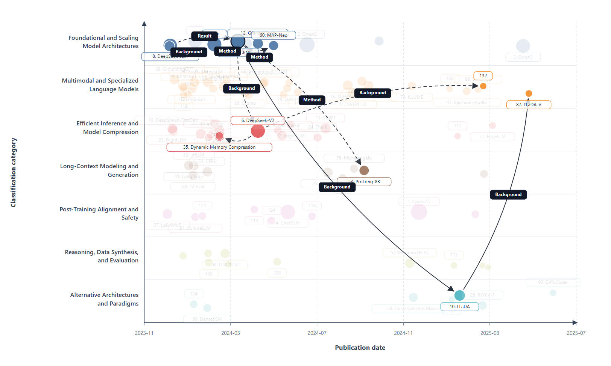

# EvoMap: From Topic to Academic Evolution Maps

<p align="center">
  <b>An interactive system for topic-driven literature taxonomy construction and academic evolution mapping.</b>
</p>

<p align="center">
  <a href="https://chute-undercoat-moonlit.ngrok-free.dev"><b>🚀 Try the Demo</b></a> ·
  <a href="./PaperTaxoBench/"><b>📊 PaperTaxoBench</b></a>
</p>


---

## 🌟 Overview

**EvoMap** is an end-to-end framework that transforms a user-specified research topic into three structured outputs:

- a **relevant paper set** for the target topic;
- a **hierarchical taxonomy** that organizes the field into categories and subcategories;
- a **time-aware evolution map** that visualizes representative papers and their development trajectories.

Unlike text-only survey generation systems, EvoMap produces an interactive visual map for literature exploration. Papers are positioned by **publication time** on the x-axis and by **taxonomy category** on the y-axis. Node size indicates academic impact, while directed edges represent citation-based developmental relations with intent labels such as **Background**, **Method**, and **Result Comparison**.

This design enables users to inspect the overall topic structure, identify representative works across different periods, and trace how a paper or subtopic evolves from prior research.

---

## 💻 Demo

We provide an online demo for interacting with the EvoMap system.

👉 **[Click Here to Access the Demo](https://chute-undercoat-moonlit.ngrok-free.dev)**

Through the demo, users can explore how EvoMap transforms a research topic into a structured literature map, including a hierarchical taxonomy, representative papers, temporal evolution patterns, and citation-intent-aware paper relations.


---

## 🧭 Key Features

- **Topic-driven literature exploration**  
  Starts from a topic query rather than a single seed paper.

- **Hierarchical taxonomy construction**  
  Organizes retrieved papers into multi-level research categories.

- **Time-aware evolution visualization**  
  Reveals how representative papers and research branches develop over time.

- **Citation-intent-aware relation tracing**  
  Explains paper connections through citation-intent labels such as **Background**, **Method**, and **Result Comparison**.

- **Multi-level interactive exploration**  
  Supports root-level overview, subcategory-level exploration, and paper-level trajectory analysis.

---

## 🗺️ Example Evolution Map

### Root-level Overview

This view presents the overall temporal evolution and category structure of a research topic. It helps users quickly identify major research branches, active periods, and representative papers.

<p align="center">
  
</p>

---

### Subcategory Exploration

This view supports deeper exploration within a selected branch, revealing finer-grained subtopics and internal evolution patterns.

<p align="center">
  
</p>

---

### Paper-level Trajectory

Selecting a paper node reveals its local development trajectory. EvoMap highlights how the paper connects to prior work through citation-intent labels such as **Background**, **Method**, and **Result Comparison**.

<p align="center">
  
</p>

---

## 📊 Benchmark: PaperTaxoBench

To support rigorous evaluation of taxonomy construction, we introduce **PaperTaxoBench**, an expert-aligned benchmark derived from real-world survey structures and section-level citation behavior.

PaperTaxoBench is constructed from published survey papers. Each survey's hierarchical section structure is converted into expert-defined **Taxonomy Paths**, and citations appearing under each path are collected as the corresponding **Cited Paper Set**.

### Benchmark Statistics

| Item | Number |
|---|---:|
| Research tracks | 12 |
| Survey papers | 50 |
| Taxonomy paths | 1,876 |
| Citation occurrences | 27,950 |

### Location

```text
./PaperTaxoBench/